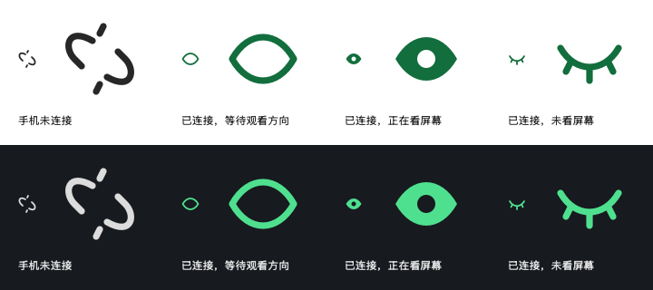

# 桌面连接与观看方向图标

2026-10-19用户确认。Mac菜单栏与Windows任务栏通知区域采用相同含义；颜色表示认证连接，眼睛形态表示观看方向，不表示播放器是否暂停。没有动画或额外通知。

| 状态值 | 用户场景 | 轮廓与颜色 |
|---|---|---|
| disconnected | 未连接、待配对、断线/超时或接收端未就绪 | 系统单色断链 |
| waiting | 已认证但未开始、刚开始等待方向、停止观影或UNKNOWN | 绿色空心眼睛 |
| attending | 已认证且观影中的ATTENDING | 绿色实心睁眼，瞳孔留白 |
| away | 已认证且观影中的AWAY/NO_FACE | 绿色弧线闭眼，三根短睫毛 |



连接优先于观看方向；发现或未批准设备不变绿。STOP保留连接但清除方向，重连后等待新START与新方向，不沿用旧睁眼。UNKNOWN回到空心，媒体归属仍按原裁决器保护规则独立处理。图标不说明相机是否故障或视频是否暂停，详情看现有菜单文字；权限不足沿用菜单提示。tooltip与辅助功能名称同时更新。

## 实现与边界

- Mac：Receiver从active认证会话和MediaSession只读isWatching/lastIntent计算DesktopStatus；MenuApp刷新20pt原生矢量图，接收意图即刷新，不解析中文状态文案。原生绘图采用[NSImage绘图闭包](https://developer.apple.com/documentation/appkit/nsimage/init(size:flipped:drawinghandler:))。相同图像在深浅色切换后仍更新配色，已做绘图回归。
- Windows：目录目前仅占位，无接收端/NotifyIcon入口。本次提供同源绘图导出的light/dark两套ICO，每个含16/20/24/32/40/48/64像素。**素材已准备不代表Windows功能已实现或验证**；需在Windows开发时接相同认证/START/STOP/方向/断线生命周期，补主题、缩放和实际托盘截图，不另造媒体裁决。
- Mac当前技术证据与普通入口结果见[本轮报告](comet/reports/2026-10-19-desktop-status-icons.md)。未补新的S25实体动作，Windows结果仍GAP，不据此关闭父阶段或合main。

## 素材再生成

在项目根目录运行，无额外依赖：

```sh
mkdir -p .local/status-icon-assets
PAUSEPAL_ICON_ASSETS="$PWD/.local/status-icon-assets" PAUSEPAL_ICON_PREVIEW="$PWD/.local/status-icons-preview.png" swift test --package-path apps/macos --filter StatusIconTests
python3 tools/export-desktop-icons.py .local/status-icon-assets docs/assets/desktop-status
cp .local/status-icons-preview.png docs/assets/desktop-status/preview.png
```

源轮廓在apps/macos/Sources/LookPauseMediaProbe/StatusIcon.swift，20×20坐标；连接绿浅色为(0.07,0.43,0.24)，深色为(0.31,0.88,0.56)。Mac断链使用系统template自适应；Windows选择对应主题ICO，尚待Windows原生主题取色验收。
